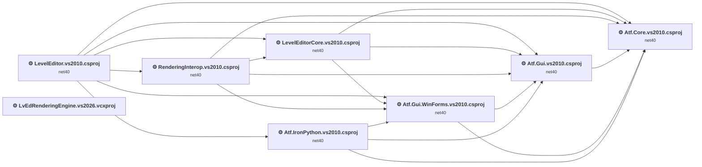
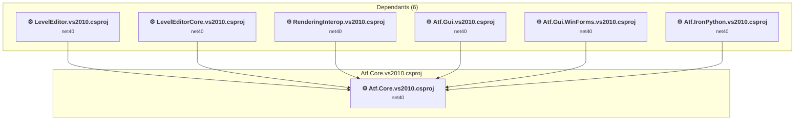
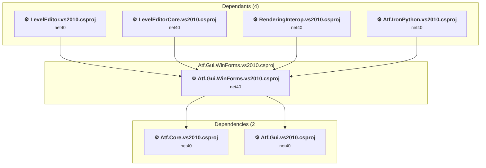
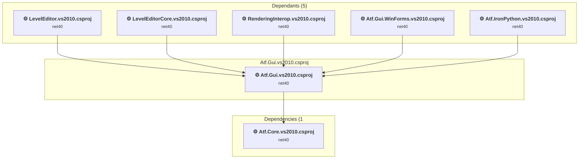
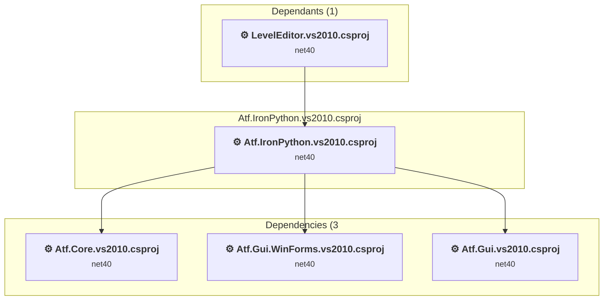
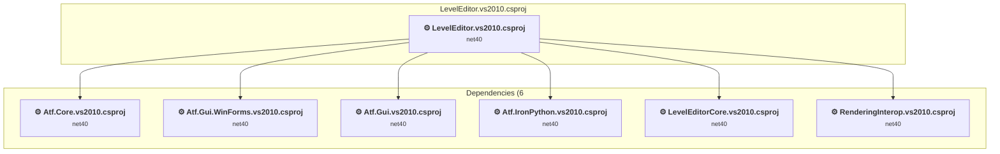
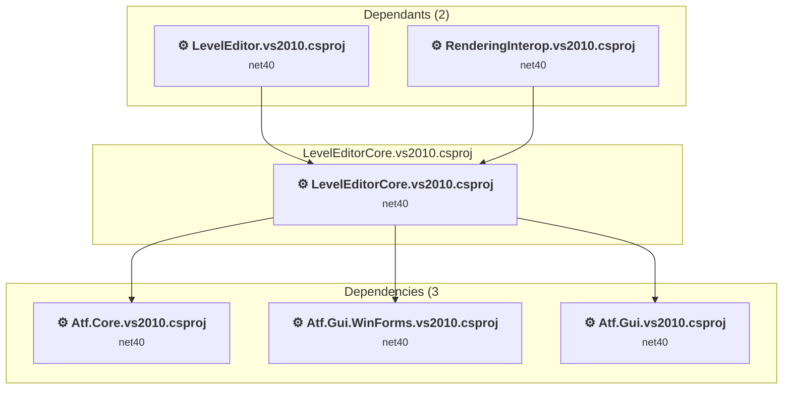
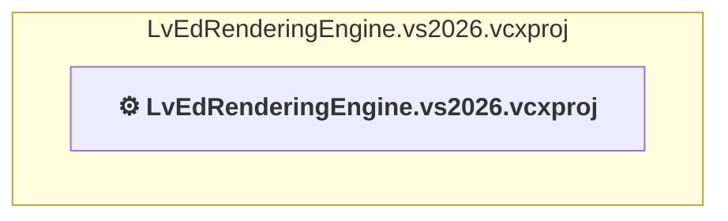
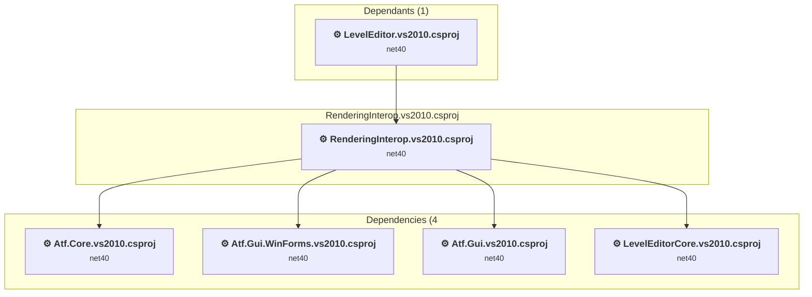

# Projects and dependencies analysis

This document provides a comprehensive overview of the projects and their dependencies in the context of upgrading to .NETCoreApp,Version=v10.0.

## Table of Contents

- [Executive Summary](#executive-Summary)
  - [Highlevel Metrics](#highlevel-metrics)
  - [Projects Compatibility](#projects-compatibility)
  - [Package Compatibility](#package-compatibility)
  - [API Compatibility](#api-compatibility)
  - [Binding Redirect Configuration](#binding-redirect-configuration)
- [Aggregate NuGet packages details](#aggregate-nuget-packages-details)
- [Top API Migration Challenges](#top-api-migration-challenges)
  - [Technologies and Features](#technologies-and-features)
  - [Most Frequent API Issues](#most-frequent-api-issues)
- [Projects Relationship Graph](#projects-relationship-graph)
- [Project Details](#project-details)

  - [e:\Users\mitch\source\repos\LevelEditor\ATF\Framework\Atf.Core\Atf.Core.vs2010.csproj](#e:usersmitchsourcereposleveleditoratfframeworkatfcoreatfcorevs2010csproj)
  - [e:\Users\mitch\source\repos\LevelEditor\ATF\Framework\Atf.Gui.WinForms\Atf.Gui.WinForms.vs2010.csproj](#e:usersmitchsourcereposleveleditoratfframeworkatfguiwinformsatfguiwinformsvs2010csproj)
  - [e:\Users\mitch\source\repos\LevelEditor\ATF\Framework\Atf.Gui\Atf.Gui.vs2010.csproj](#e:usersmitchsourcereposleveleditoratfframeworkatfguiatfguivs2010csproj)
  - [e:\Users\mitch\source\repos\LevelEditor\ATF\Framework\Atf.IronPython\Atf.IronPython.vs2010.csproj](#e:usersmitchsourcereposleveleditoratfframeworkatfironpythonatfironpythonvs2010csproj)
  - [e:\Users\mitch\source\repos\LevelEditor\LevelEditor\LevelEditor.vs2010.csproj](#e:usersmitchsourcereposleveleditorleveleditorleveleditorvs2010csproj)
  - [e:\Users\mitch\source\repos\LevelEditor\LevelEditorCore\LevelEditorCore.vs2010.csproj](#e:usersmitchsourcereposleveleditorleveleditorcoreleveleditorcorevs2010csproj)
  - [e:\Users\mitch\source\repos\LevelEditor\LevelEditorNativeRendering\LvEdRenderingEngine\LvEdRenderingEngine.vs2026.vcxproj](#e:usersmitchsourcereposleveleditorleveleditornativerenderinglvedrenderingenginelvedrenderingenginevs2026vcxproj)
  - [e:\Users\mitch\source\repos\LevelEditor\LevelEditorNativeRendering\RenderingInterop.vs2010.csproj](#e:usersmitchsourcereposleveleditorleveleditornativerenderingrenderinginteropvs2010csproj)

## Executive Summary

### Highlevel Metrics

| Metric | Count | Status |
| :--- | :---: | :--- |
| Total Projects | 8 | 7 require upgrade |
| Total NuGet Packages | 0 | All compatible |
| Total Code Files | 1100 |  |
| Total Code Files with Incidents | 510 |  |
| Total Lines of Code | 240161 |  |
| Total Number of Issues | 37849 |  |
| Estimated LOC to modify | 37828+ | at least 15.8% of codebase |

### Projects Compatibility

| Project | Target Framework | Difficulty | Package Issues | API Issues | Binding Issues | Est. LOC Impact | Description |
| :--- | :---: | :---: | :---: | :---: | :---: | :---: | :--- |
| [e:\Users\mitch\source\repos\LevelEditor\ATF\Framework\Atf.Core\Atf.Core.vs2010.csproj](#e:usersmitchsourcereposleveleditoratfframeworkatfcoreatfcorevs2010csproj) | net40 | 🟢 Low | 0 | 178 | 1 | 178+ | ClassicClassLibrary, Sdk Style = False |
| [e:\Users\mitch\source\repos\LevelEditor\ATF\Framework\Atf.Gui.WinForms\Atf.Gui.WinForms.vs2010.csproj](#e:usersmitchsourcereposleveleditoratfframeworkatfguiwinformsatfguiwinformsvs2010csproj) | net40 | 🟡 Medium | 0 | 31636 | 1 | 31636+ | ClassicWinForms, Sdk Style = False |
| [e:\Users\mitch\source\repos\LevelEditor\ATF\Framework\Atf.Gui\Atf.Gui.vs2010.csproj](#e:usersmitchsourcereposleveleditoratfframeworkatfguiatfguivs2010csproj) | net40 | 🟡 Medium | 0 | 799 | 1 | 799+ | ClassicClassLibrary, Sdk Style = False |
| [e:\Users\mitch\source\repos\LevelEditor\ATF\Framework\Atf.IronPython\Atf.IronPython.vs2010.csproj](#e:usersmitchsourcereposleveleditoratfframeworkatfironpythonatfironpythonvs2010csproj) | net40 | 🟢 Low | 0 | 21 | 1 | 21+ | ClassicWinForms, Sdk Style = False |
| [e:\Users\mitch\source\repos\LevelEditor\LevelEditor\LevelEditor.vs2010.csproj](#e:usersmitchsourcereposleveleditorleveleditorleveleditorvs2010csproj) | net40 | 🟡 Medium | 0 | 3758 | 1 | 3758+ | ClassicWinForms, Sdk Style = False |
| [e:\Users\mitch\source\repos\LevelEditor\LevelEditorCore\LevelEditorCore.vs2010.csproj](#e:usersmitchsourcereposleveleditorleveleditorcoreleveleditorcorevs2010csproj) | net40 | 🟡 Medium | 0 | 1074 | 1 | 1074+ | ClassicWinForms, Sdk Style = False |
| [e:\Users\mitch\source\repos\LevelEditor\LevelEditorNativeRendering\LvEdRenderingEngine\LvEdRenderingEngine.vs2026.vcxproj](#e:usersmitchsourcereposleveleditorleveleditornativerenderinglvedrenderingenginelvedrenderingenginevs2026vcxproj) |  | ✅ None | 0 | 0 | 0 |  | ClassicClassLibrary, Sdk Style = False |
| [e:\Users\mitch\source\repos\LevelEditor\LevelEditorNativeRendering\RenderingInterop.vs2010.csproj](#e:usersmitchsourcereposleveleditorleveleditornativerenderingrenderinginteropvs2010csproj) | net40 | 🟡 Medium | 0 | 362 | 1 | 362+ | ClassicWinForms, Sdk Style = False |

### Package Compatibility

| Status | Count | Percentage |
| :--- | :---: | :---: |
| ✅ Compatible | 0 | 0.0% |
| ⚠️ Incompatible | 0 | 0.0% |
| 🔄 Upgrade Recommended | 0 | 0.0% |
| ***Total NuGet Packages*** | ***0*** | ***100%*** |

### API Compatibility

| Category | Count | Impact |
| :--- | :---: | :--- |
| 🔴 Binary Incompatible | 30188 | High - Require code changes |
| 🟡 Source Incompatible | 7022 | Medium - Needs re-compilation and potential conflicting API error fixing |
| 🔵 Behavioral change | 618 | Low - Behavioral changes that may require testing at runtime |
| ✅ Compatible | 262587 |  |
| ***Total APIs Analyzed*** | ***300415*** |  |

### Binding Redirect Configuration

| Severity | Count | Description |
| :--- | :---: | :--- |
| 🟡Potential | 7 | May cause issues in certain scenarios |
| ***Total Binding Issues*** | ***7*** | ***Across 7 project(s)*** |

## Aggregate NuGet packages details

| Package | Current Version | Suggested Version | Projects | Description |
| :--- | :---: | :---: | :--- | :--- |

## Top API Migration Challenges

### Technologies and Features

| Technology | Issues | Percentage | Migration Path |
| :--- | :---: | :---: | :--- |
| Windows Forms | 29940 | 79.1% | Windows Forms APIs for building Windows desktop applications with traditional Forms-based UI that are available in .NET on Windows. Enable Windows Desktop support: Option 1 (Recommended): Target net9.0-windows; Option 2: Add <UseWindowsDesktop>true</UseWindowsDesktop>; Option 3 (Legacy): Use Microsoft.NET.Sdk.WindowsDesktop SDK. |
| GDI+ / System.Drawing | 5750 | 15.2% | System.Drawing APIs for 2D graphics, imaging, and printing that are available via NuGet package System.Drawing.Common. Note: Not recommended for server scenarios due to Windows dependencies; consider cross-platform alternatives like SkiaSharp or ImageSharp for new code. |
| Deprecated Remoting & Serialization | 53 | 0.1% | Legacy .NET Remoting, BinaryFormatter, and related serialization APIs that are deprecated and removed for security reasons. Remoting provided distributed object communication but had significant security vulnerabilities. Migrate to gRPC, HTTP APIs, or modern serialization (System.Text.Json, protobuf). |
| Windows Forms Legacy Controls | 50 | 0.1% | Legacy Windows Forms controls that have been removed from .NET Core/5+ including StatusBar, DataGrid, ContextMenu, MainMenu, MenuItem, and ToolBar. These controls were replaced by more modern alternatives. Use ToolStrip, MenuStrip, ContextMenuStrip, and DataGridView instead. |
| ASP.NET Framework (System.Web) | 42 | 0.1% | Legacy ASP.NET Framework APIs for web applications (System.Web.*) that don't exist in ASP.NET Core due to architectural differences. ASP.NET Core represents a complete redesign of the web framework. Migrate to ASP.NET Core equivalents or consider System.Web.Adapters package for compatibility. |
| WPF (Windows Presentation Foundation) | 23 | 0.1% | WPF APIs for building Windows desktop applications with XAML-based UI that are available in .NET on Windows. WPF provides rich desktop UI capabilities with data binding and styling. Enable Windows Desktop support: Option 1 (Recommended): Target net9.0-windows; Option 2: Add <UseWindowsDesktop>true</UseWindowsDesktop>. |
| Code Access Security (CAS) | 1 | 0.0% | Code Access Security (CAS) APIs that were removed in .NET Core/.NET for security and performance reasons. CAS provided fine-grained security policies but proved complex and ineffective. Remove CAS usage; not supported in modern .NET. |
| AppDomain APIs | 1 | 0.0% | AppDomain-related APIs that are unsupported in .NET Core due to architectural changes. AppDomains were used for isolation but have been replaced by AssemblyLoadContext API for loading assemblies. Most AppDomain scenarios are not supported; redesign application isolation approach. |

### Most Frequent API Issues

| API | Count | Percentage | Category |
| :--- | :---: | :---: | :--- |
| T:System.Windows.Forms.Keys | 1336 | 3.5% | Binary Incompatible |
| T:System.Windows.Forms.Label | 775 | 2.0% | Binary Incompatible |
| T:System.Windows.Forms.TextBox | 755 | 2.0% | Binary Incompatible |
| T:System.Windows.Forms.Control | 729 | 1.9% | Binary Incompatible |
| T:System.Windows.Forms.Button | 726 | 1.9% | Binary Incompatible |
| T:System.Uri | 548 | 1.4% | Behavioral Change |
| T:System.Windows.Forms.Control.ControlCollection | 524 | 1.4% | Binary Incompatible |
| P:System.Windows.Forms.Control.Controls | 524 | 1.4% | Binary Incompatible |
| T:System.Windows.Forms.MouseButtons | 484 | 1.3% | Binary Incompatible |
| T:System.Drawing.Pen | 467 | 1.2% | Source Incompatible |
| T:System.Drawing.Brush | 430 | 1.1% | Source Incompatible |
| M:System.Windows.Forms.Control.ControlCollection.Add(System.Windows.Forms.Control) | 416 | 1.1% | Binary Incompatible |
| T:System.Drawing.Image | 409 | 1.1% | Source Incompatible |
| P:System.Windows.Forms.Control.Name | 396 | 1.0% | Binary Incompatible |
| T:System.Drawing.Graphics | 382 | 1.0% | Source Incompatible |
| T:System.Windows.Forms.Cursor | 369 | 1.0% | Binary Incompatible |
| T:System.Drawing.Font | 362 | 1.0% | Source Incompatible |
| T:System.Windows.Forms.DialogResult | 362 | 1.0% | Binary Incompatible |
| T:System.Windows.Forms.ListView | 362 | 1.0% | Binary Incompatible |
| T:System.Windows.Forms.MouseEventArgs | 353 | 0.9% | Binary Incompatible |
| T:System.Windows.Forms.MouseEventHandler | 336 | 0.9% | Binary Incompatible |
| T:System.Windows.Forms.RadioButton | 335 | 0.9% | Binary Incompatible |
| T:System.Windows.Forms.ToolStripButton | 320 | 0.8% | Binary Incompatible |
| T:System.Drawing.Drawing2D.Matrix | 309 | 0.8% | Source Incompatible |
| T:System.Windows.Forms.DockStyle | 296 | 0.8% | Binary Incompatible |
| M:System.ComponentModel.Composition.ExportAttribute.#ctor(System.Type) | 281 | 0.7% | Source Incompatible |
| T:System.ComponentModel.Composition.ExportAttribute | 281 | 0.7% | Source Incompatible |
| P:System.Windows.Forms.Control.Height | 262 | 0.7% | Binary Incompatible |
| T:System.Windows.Forms.Form | 261 | 0.7% | Binary Incompatible |
| T:System.Drawing.SolidBrush | 252 | 0.7% | Source Incompatible |
| T:System.Windows.Forms.ToolStripMenuItem | 246 | 0.7% | Binary Incompatible |
| T:System.Windows.Forms.ImageList | 241 | 0.6% | Binary Incompatible |
| T:System.Windows.Forms.ComboBox | 239 | 0.6% | Binary Incompatible |
| M:System.Windows.Forms.Control.Invalidate | 231 | 0.6% | Binary Incompatible |
| P:System.Windows.Forms.TextBox.Text | 225 | 0.6% | Binary Incompatible |
| T:System.Windows.Forms.AnchorStyles | 218 | 0.6% | Binary Incompatible |
| T:System.Windows.Forms.ToolStrip | 210 | 0.6% | Binary Incompatible |
| T:System.Windows.Forms.Padding | 210 | 0.6% | Binary Incompatible |
| P:System.Windows.Forms.Control.Width | 209 | 0.6% | Binary Incompatible |
| T:System.Windows.Forms.BoundsSpecified | 203 | 0.5% | Binary Incompatible |
| T:System.Windows.Forms.ToolStripItemCollection | 193 | 0.5% | Binary Incompatible |
| T:System.Windows.Forms.SplitContainer | 184 | 0.5% | Binary Incompatible |
| T:System.Drawing.StringFormat | 160 | 0.4% | Source Incompatible |
| T:System.Drawing.StringAlignment | 156 | 0.4% | Source Incompatible |
| T:System.Windows.Forms.ControlStyles | 152 | 0.4% | Binary Incompatible |
| T:System.Windows.Forms.Timer | 150 | 0.4% | Binary Incompatible |
| T:System.Windows.Forms.ListViewItem | 148 | 0.4% | Binary Incompatible |
| P:System.Windows.Forms.MouseEventArgs.Button | 142 | 0.4% | Binary Incompatible |
| M:System.ComponentModel.Composition.PartCreationPolicyAttribute.#ctor(System.ComponentModel.Composition.CreationPolicy) | 141 | 0.4% | Source Incompatible |
| T:System.ComponentModel.Composition.PartCreationPolicyAttribute | 141 | 0.4% | Source Incompatible |

## Projects Relationship Graph

Legend:
📦 SDK-style project
⚙️ Classic project

## Project Details

### e:\Users\mitch\source\repos\LevelEditor\ATF\Framework\Atf.Core\Atf.Core.vs2010.csproj

#### Project Info

- **Current Target Framework:** net40
- **Proposed Target Framework:** net10.0
- **SDK-style**: False
- **Project Kind:** ClassicClassLibrary
- **Dependencies**: 0
- **Dependants**: 6
- **Number of Files**: 213
- **Number of Files with Incidents**: 28
- **Lines of Code**: 31372
- **Estimated LOC to modify**: 178+ (at least 0.6% of the project)

#### Dependency Graph

Legend:
📦 SDK-style project
⚙️ Classic project

### API Compatibility

| Category | Count | Impact |
| :--- | :---: | :--- |
| 🔴 Binary Incompatible | 0 | High - Require code changes |
| 🟡 Source Incompatible | 73 | Medium - Needs re-compilation and potential conflicting API error fixing |
| 🔵 Behavioral change | 105 | Low - Behavioral changes that may require testing at runtime |
| ✅ Compatible | 32133 |  |
| ***Total APIs Analyzed*** | ***32311*** |  |

#### Project Package References

| Package | Type | Current Version | Suggested Version | Description |
| :--- | :---: | :---: | :---: | :--- |

#### Binding Redirect Configuration

| Rule | Severity | Details | Recommendation |
| :--- | :---: | :--- | :--- |
| AutoGenerateBindingRedirects not set and no manual redirects | 🟡Potential | AutoGenerateBindingRedirects is not set in Atf.Core.vs2010.csproj, no manual redirects found | Explicitly enable <AutoGenerateBindingRedirects>true</AutoGenerateBindingRedirects> or add manual binding redirects. |

#### Project Technologies and Features

| Technology | Issues | Percentage | Migration Path |
| :--- | :---: | :---: | :--- |
| GDI+ / System.Drawing | 2 | 1.1% | System.Drawing APIs for 2D graphics, imaging, and printing that are available via NuGet package System.Drawing.Common. Note: Not recommended for server scenarios due to Windows dependencies; consider cross-platform alternatives like SkiaSharp or ImageSharp for new code. |

### e:\Users\mitch\source\repos\LevelEditor\ATF\Framework\Atf.Gui.WinForms\Atf.Gui.WinForms.vs2010.csproj

#### Project Info

- **Current Target Framework:** net40
- **Proposed Target Framework:** net10.0-windows
- **SDK-style**: False
- **Project Kind:** ClassicWinForms
- **Dependencies**: 2
- **Dependants**: 4
- **Number of Files**: 406
- **Number of Files with Incidents**: 323
- **Lines of Code**: 129314
- **Estimated LOC to modify**: 31636+ (at least 24.5% of the project)

#### Dependency Graph

Legend:
📦 SDK-style project
⚙️ Classic project

### API Compatibility

| Category | Count | Impact |
| :--- | :---: | :--- |
| 🔴 Binary Incompatible | 25920 | High - Require code changes |
| 🟡 Source Incompatible | 5581 | Medium - Needs re-compilation and potential conflicting API error fixing |
| 🔵 Behavioral change | 135 | Low - Behavioral changes that may require testing at runtime |
| ✅ Compatible | 140676 |  |
| ***Total APIs Analyzed*** | ***172312*** |  |

#### Project Package References

| Package | Type | Current Version | Suggested Version | Description |
| :--- | :---: | :---: | :---: | :--- |

#### Binding Redirect Configuration

| Rule | Severity | Details | Recommendation |
| :--- | :---: | :--- | :--- |
| AutoGenerateBindingRedirects not set and no manual redirects | 🟡Potential | AutoGenerateBindingRedirects is not set in Atf.Gui.WinForms.vs2010.csproj, no manual redirects found | Explicitly enable <AutoGenerateBindingRedirects>true</AutoGenerateBindingRedirects> or add manual binding redirects. |

#### Project Technologies and Features

| Technology | Issues | Percentage | Migration Path |
| :--- | :---: | :---: | :--- |
| Code Access Security (CAS) | 1 | 0.0% | Code Access Security (CAS) APIs that were removed in .NET Core/.NET for security and performance reasons. CAS provided fine-grained security policies but proved complex and ineffective. Remove CAS usage; not supported in modern .NET. |
| Windows Forms Legacy Controls | 50 | 0.2% | Legacy Windows Forms controls that have been removed from .NET Core/5+ including StatusBar, DataGrid, ContextMenu, MainMenu, MenuItem, and ToolBar. These controls were replaced by more modern alternatives. Use ToolStrip, MenuStrip, ContextMenuStrip, and DataGridView instead. |
| WPF (Windows Presentation Foundation) | 23 | 0.1% | WPF APIs for building Windows desktop applications with XAML-based UI that are available in .NET on Windows. WPF provides rich desktop UI capabilities with data binding and styling. Enable Windows Desktop support: Option 1 (Recommended): Target net9.0-windows; Option 2: Add <UseWindowsDesktop>true</UseWindowsDesktop>. |
| Deprecated Remoting & Serialization | 51 | 0.2% | Legacy .NET Remoting, BinaryFormatter, and related serialization APIs that are deprecated and removed for security reasons. Remoting provided distributed object communication but had significant security vulnerabilities. Migrate to gRPC, HTTP APIs, or modern serialization (System.Text.Json, protobuf). |
| AppDomain APIs | 1 | 0.0% | AppDomain-related APIs that are unsupported in .NET Core due to architectural changes. AppDomains were used for isolation but have been replaced by AssemblyLoadContext API for loading assemblies. Most AppDomain scenarios are not supported; redesign application isolation approach. |
| Windows Forms | 25741 | 81.4% | Windows Forms APIs for building Windows desktop applications with traditional Forms-based UI that are available in .NET on Windows. Enable Windows Desktop support: Option 1 (Recommended): Target net9.0-windows; Option 2: Add <UseWindowsDesktop>true</UseWindowsDesktop>; Option 3 (Legacy): Use Microsoft.NET.Sdk.WindowsDesktop SDK. |
| GDI+ / System.Drawing | 5013 | 15.8% | System.Drawing APIs for 2D graphics, imaging, and printing that are available via NuGet package System.Drawing.Common. Note: Not recommended for server scenarios due to Windows dependencies; consider cross-platform alternatives like SkiaSharp or ImageSharp for new code. |

### e:\Users\mitch\source\repos\LevelEditor\ATF\Framework\Atf.Gui\Atf.Gui.vs2010.csproj

#### Project Info

- **Current Target Framework:** net40
- **Proposed Target Framework:** net10.0
- **SDK-style**: False
- **Project Kind:** ClassicClassLibrary
- **Dependencies**: 1
- **Dependants**: 5
- **Number of Files**: 586
- **Number of Files with Incidents**: 57
- **Lines of Code**: 48778
- **Estimated LOC to modify**: 799+ (at least 1.6% of the project)

#### Dependency Graph

Legend:
📦 SDK-style project
⚙️ Classic project

### API Compatibility

| Category | Count | Impact |
| :--- | :---: | :--- |
| 🔴 Binary Incompatible | 68 | High - Require code changes |
| 🟡 Source Incompatible | 549 | Medium - Needs re-compilation and potential conflicting API error fixing |
| 🔵 Behavioral change | 182 | Low - Behavioral changes that may require testing at runtime |
| ✅ Compatible | 48068 |  |
| ***Total APIs Analyzed*** | ***48867*** |  |

#### Project Package References

| Package | Type | Current Version | Suggested Version | Description |
| :--- | :---: | :---: | :---: | :--- |

#### Binding Redirect Configuration

| Rule | Severity | Details | Recommendation |
| :--- | :---: | :--- | :--- |
| AutoGenerateBindingRedirects not set and no manual redirects | 🟡Potential | AutoGenerateBindingRedirects is not set in Atf.Gui.vs2010.csproj, no manual redirects found | Explicitly enable <AutoGenerateBindingRedirects>true</AutoGenerateBindingRedirects> or add manual binding redirects. |

#### Project Technologies and Features

| Technology | Issues | Percentage | Migration Path |
| :--- | :---: | :---: | :--- |
| ASP.NET Framework (System.Web) | 42 | 5.3% | Legacy ASP.NET Framework APIs for web applications (System.Web.*) that don't exist in ASP.NET Core due to architectural differences. ASP.NET Core represents a complete redesign of the web framework. Migrate to ASP.NET Core equivalents or consider System.Web.Adapters package for compatibility. |
| Deprecated Remoting & Serialization | 2 | 0.3% | Legacy .NET Remoting, BinaryFormatter, and related serialization APIs that are deprecated and removed for security reasons. Remoting provided distributed object communication but had significant security vulnerabilities. Migrate to gRPC, HTTP APIs, or modern serialization (System.Text.Json, protobuf). |
| GDI+ / System.Drawing | 367 | 45.9% | System.Drawing APIs for 2D graphics, imaging, and printing that are available via NuGet package System.Drawing.Common. Note: Not recommended for server scenarios due to Windows dependencies; consider cross-platform alternatives like SkiaSharp or ImageSharp for new code. |

### e:\Users\mitch\source\repos\LevelEditor\ATF\Framework\Atf.IronPython\Atf.IronPython.vs2010.csproj

#### Project Info

- **Current Target Framework:** net40
- **Proposed Target Framework:** net10.0-windows
- **SDK-style**: False
- **Project Kind:** ClassicWinForms
- **Dependencies**: 3
- **Dependants**: 1
- **Number of Files**: 3
- **Number of Files with Incidents**: 3
- **Lines of Code**: 222
- **Estimated LOC to modify**: 21+ (at least 9.5% of the project)

#### Dependency Graph

Legend:
📦 SDK-style project
⚙️ Classic project

### API Compatibility

| Category | Count | Impact |
| :--- | :---: | :--- |
| 🔴 Binary Incompatible | 3 | High - Require code changes |
| 🟡 Source Incompatible | 18 | Medium - Needs re-compilation and potential conflicting API error fixing |
| 🔵 Behavioral change | 0 | Low - Behavioral changes that may require testing at runtime |
| ✅ Compatible | 161 |  |
| ***Total APIs Analyzed*** | ***182*** |  |

#### Project Package References

| Package | Type | Current Version | Suggested Version | Description |
| :--- | :---: | :---: | :---: | :--- |

#### Binding Redirect Configuration

| Rule | Severity | Details | Recommendation |
| :--- | :---: | :--- | :--- |
| AutoGenerateBindingRedirects not set and no manual redirects | 🟡Potential | AutoGenerateBindingRedirects is not set in Atf.IronPython.vs2010.csproj, no manual redirects found | Explicitly enable <AutoGenerateBindingRedirects>true</AutoGenerateBindingRedirects> or add manual binding redirects. |

#### Project Technologies and Features

| Technology | Issues | Percentage | Migration Path |
| :--- | :---: | :---: | :--- |
| Windows Forms | 3 | 14.3% | Windows Forms APIs for building Windows desktop applications with traditional Forms-based UI that are available in .NET on Windows. Enable Windows Desktop support: Option 1 (Recommended): Target net9.0-windows; Option 2: Add <UseWindowsDesktop>true</UseWindowsDesktop>; Option 3 (Legacy): Use Microsoft.NET.Sdk.WindowsDesktop SDK. |

### e:\Users\mitch\source\repos\LevelEditor\LevelEditor\LevelEditor.vs2010.csproj

#### Project Info

- **Current Target Framework:** net40
- **Proposed Target Framework:** net10.0-windows
- **SDK-style**: False
- **Project Kind:** ClassicWinForms
- **Dependencies**: 6
- **Dependants**: 0
- **Number of Files**: 72
- **Number of Files with Incidents**: 51
- **Lines of Code**: 13949
- **Estimated LOC to modify**: 3758+ (at least 26.9% of the project)

#### Dependency Graph

Legend:
📦 SDK-style project
⚙️ Classic project

### API Compatibility

| Category | Count | Impact |
| :--- | :---: | :--- |
| 🔴 Binary Incompatible | 3160 | High - Require code changes |
| 🟡 Source Incompatible | 457 | Medium - Needs re-compilation and potential conflicting API error fixing |
| 🔵 Behavioral change | 141 | Low - Behavioral changes that may require testing at runtime |
| ✅ Compatible | 20363 |  |
| ***Total APIs Analyzed*** | ***24121*** |  |

#### Project Package References

| Package | Type | Current Version | Suggested Version | Description |
| :--- | :---: | :---: | :---: | :--- |

#### Binding Redirect Configuration

| Rule | Severity | Details | Recommendation |
| :--- | :---: | :--- | :--- |
| AutoGenerateBindingRedirects not set and no manual redirects | 🟡Potential | AutoGenerateBindingRedirects is not set in LevelEditor.vs2010.csproj, no manual redirects found | Explicitly enable <AutoGenerateBindingRedirects>true</AutoGenerateBindingRedirects> or add manual binding redirects. |

#### Project Technologies and Features

| Technology | Issues | Percentage | Migration Path |
| :--- | :---: | :---: | :--- |
| GDI+ / System.Drawing | 226 | 6.0% | System.Drawing APIs for 2D graphics, imaging, and printing that are available via NuGet package System.Drawing.Common. Note: Not recommended for server scenarios due to Windows dependencies; consider cross-platform alternatives like SkiaSharp or ImageSharp for new code. |
| Windows Forms | 3160 | 84.1% | Windows Forms APIs for building Windows desktop applications with traditional Forms-based UI that are available in .NET on Windows. Enable Windows Desktop support: Option 1 (Recommended): Target net9.0-windows; Option 2: Add <UseWindowsDesktop>true</UseWindowsDesktop>; Option 3 (Legacy): Use Microsoft.NET.Sdk.WindowsDesktop SDK. |

### e:\Users\mitch\source\repos\LevelEditor\LevelEditorCore\LevelEditorCore.vs2010.csproj

#### Project Info

- **Current Target Framework:** net40
- **Proposed Target Framework:** net10.0-windows
- **SDK-style**: False
- **Project Kind:** ClassicWinForms
- **Dependencies**: 3
- **Dependants**: 2
- **Number of Files**: 193
- **Number of Files with Incidents**: 30
- **Lines of Code**: 8694
- **Estimated LOC to modify**: 1074+ (at least 12.4% of the project)

#### Dependency Graph

Legend:
📦 SDK-style project
⚙️ Classic project

### API Compatibility

| Category | Count | Impact |
| :--- | :---: | :--- |
| 🔴 Binary Incompatible | 813 | High - Require code changes |
| 🟡 Source Incompatible | 215 | Medium - Needs re-compilation and potential conflicting API error fixing |
| 🔵 Behavioral change | 46 | Low - Behavioral changes that may require testing at runtime |
| ✅ Compatible | 9296 |  |
| ***Total APIs Analyzed*** | ***10370*** |  |

#### Project Package References

| Package | Type | Current Version | Suggested Version | Description |
| :--- | :---: | :---: | :---: | :--- |

#### Binding Redirect Configuration

| Rule | Severity | Details | Recommendation |
| :--- | :---: | :--- | :--- |
| AutoGenerateBindingRedirects not set and no manual redirects | 🟡Potential | AutoGenerateBindingRedirects is not set in LevelEditorCore.vs2010.csproj, no manual redirects found | Explicitly enable <AutoGenerateBindingRedirects>true</AutoGenerateBindingRedirects> or add manual binding redirects. |

#### Project Technologies and Features

| Technology | Issues | Percentage | Migration Path |
| :--- | :---: | :---: | :--- |
| Windows Forms | 812 | 75.6% | Windows Forms APIs for building Windows desktop applications with traditional Forms-based UI that are available in .NET on Windows. Enable Windows Desktop support: Option 1 (Recommended): Target net9.0-windows; Option 2: Add <UseWindowsDesktop>true</UseWindowsDesktop>; Option 3 (Legacy): Use Microsoft.NET.Sdk.WindowsDesktop SDK. |
| GDI+ / System.Drawing | 85 | 7.9% | System.Drawing APIs for 2D graphics, imaging, and printing that are available via NuGet package System.Drawing.Common. Note: Not recommended for server scenarios due to Windows dependencies; consider cross-platform alternatives like SkiaSharp or ImageSharp for new code. |

### e:\Users\mitch\source\repos\LevelEditor\LevelEditorNativeRendering\LvEdRenderingEngine\LvEdRenderingEngine.vs2026.vcxproj

#### Project Info

- **Current Target Framework:** ✅
- **SDK-style**: False
- **Project Kind:** ClassicClassLibrary
- **Dependencies**: 0
- **Dependants**: 0
- **Number of Files**: 0
- **Lines of Code**: 0
- **Estimated LOC to modify**: 0+ (at least 0.0% of the project)

#### Dependency Graph

Legend:
📦 SDK-style project
⚙️ Classic project

### API Compatibility

| Category | Count | Impact |
| :--- | :---: | :--- |
| 🔴 Binary Incompatible | 0 | High - Require code changes |
| 🟡 Source Incompatible | 0 | Medium - Needs re-compilation and potential conflicting API error fixing |
| 🔵 Behavioral change | 0 | Low - Behavioral changes that may require testing at runtime |
| ✅ Compatible | 0 |  |
| ***Total APIs Analyzed*** | ***0*** |  |

#### Project Package References

| Package | Type | Current Version | Suggested Version | Description |
| :--- | :---: | :---: | :---: | :--- |

### e:\Users\mitch\source\repos\LevelEditor\LevelEditorNativeRendering\RenderingInterop.vs2010.csproj

#### Project Info

- **Current Target Framework:** net40
- **Proposed Target Framework:** net10.0-windows
- **SDK-style**: False
- **Project Kind:** ClassicWinForms
- **Dependencies**: 4
- **Dependants**: 1
- **Number of Files**: 29
- **Number of Files with Incidents**: 18
- **Lines of Code**: 7832
- **Estimated LOC to modify**: 362+ (at least 4.6% of the project)

#### Dependency Graph

Legend:
📦 SDK-style project
⚙️ Classic project

### API Compatibility

| Category | Count | Impact |
| :--- | :---: | :--- |
| 🔴 Binary Incompatible | 224 | High - Require code changes |
| 🟡 Source Incompatible | 129 | Medium - Needs re-compilation and potential conflicting API error fixing |
| 🔵 Behavioral change | 9 | Low - Behavioral changes that may require testing at runtime |
| ✅ Compatible | 11890 |  |
| ***Total APIs Analyzed*** | ***12252*** |  |

#### Project Package References

| Package | Type | Current Version | Suggested Version | Description |
| :--- | :---: | :---: | :---: | :--- |

#### Binding Redirect Configuration

| Rule | Severity | Details | Recommendation |
| :--- | :---: | :--- | :--- |
| AutoGenerateBindingRedirects not set and no manual redirects | 🟡Potential | AutoGenerateBindingRedirects is not set in RenderingInterop.vs2010.csproj, no manual redirects found | Explicitly enable <AutoGenerateBindingRedirects>true</AutoGenerateBindingRedirects> or add manual binding redirects. |

#### Project Technologies and Features

| Technology | Issues | Percentage | Migration Path |
| :--- | :---: | :---: | :--- |
| GDI+ / System.Drawing | 57 | 15.7% | System.Drawing APIs for 2D graphics, imaging, and printing that are available via NuGet package System.Drawing.Common. Note: Not recommended for server scenarios due to Windows dependencies; consider cross-platform alternatives like SkiaSharp or ImageSharp for new code. |
| Windows Forms | 224 | 61.9% | Windows Forms APIs for building Windows desktop applications with traditional Forms-based UI that are available in .NET on Windows. Enable Windows Desktop support: Option 1 (Recommended): Target net9.0-windows; Option 2: Add <UseWindowsDesktop>true</UseWindowsDesktop>; Option 3 (Legacy): Use Microsoft.NET.Sdk.WindowsDesktop SDK. |

